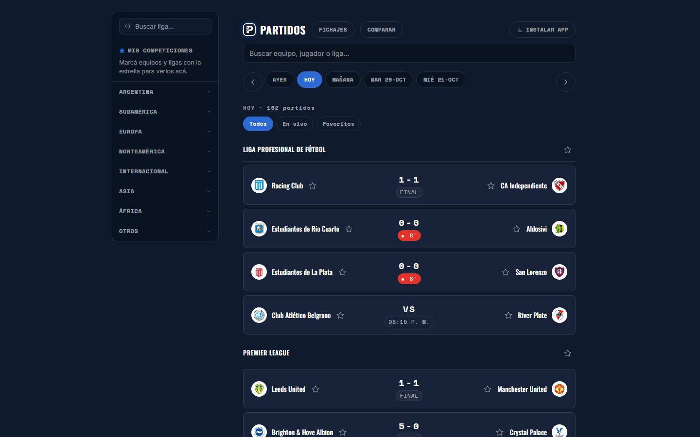
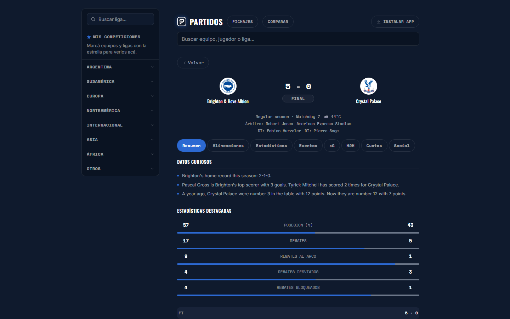
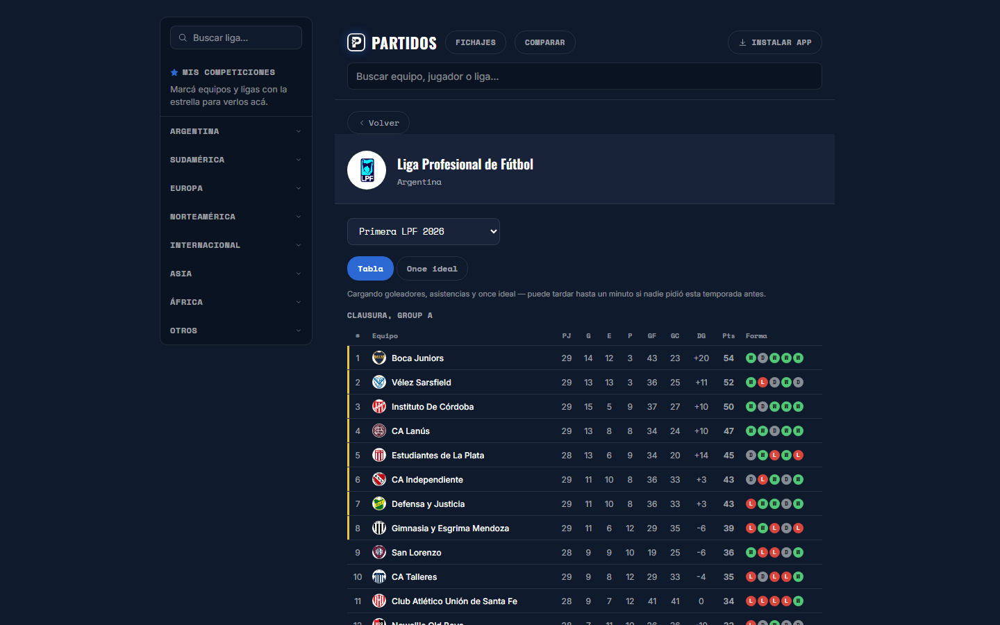
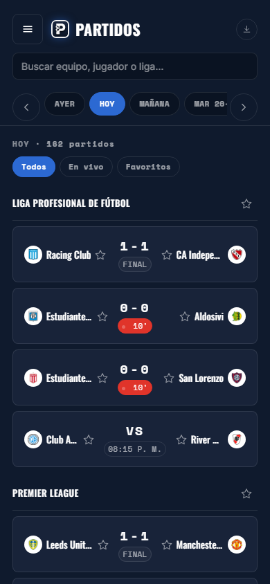

# Partidos: live football scores

**Live:** https://partidos.com.ar



| Match detail · Detalle de partido | Standings · Tabla de posiciones | Mobile · Celular |
|---|---|---|
|  |  |  |

[English](#english) · [Español](#español)

---

## English

A live football scores website: daily fixtures for 30+ leagues, live match details, standings, and pages for teams, players, coaches, referees and stadiums.

### Features

- Daily match feed grouped by league, with live scores refreshed every minute
- Match detail: events, lineups on a pitch, player stats, shot map, momentum and head-to-head
- Competition pages with standings, best XI and top players
- Team, player, coach, referee and stadium pages
- Transfers page and a player comparison tool
- Favorite teams and leagues, search, and leagues grouped by region
- Installable as an app (PWA), with SEO metadata and structured data

### Repository structure

| Folder | What it is | Stack |
|---|---|---|
| [`frontend/`](frontend) | Web app | React 19, Vite, React Router, Motion |
| [`backend/`](backend) | API in front of an external sports data provider, with caching and quota control | Node.js, Express, SQLite, Cloudflare Worker |

Each folder has its own README with architecture details.

### Engineering highlights

- Migrated the whole data layer to a new provider after the original API account was suspended, without changing the frontend contract.
- Caching with TTLs that depend on match state (1 minute for live data, 7 days for finished matches), persisted in SQLite, plus an edge cache on a Cloudflare Worker.
- A daily quota guard that stops before the provider's limit, so the site runs on a free data plan (7,500 requests/day).

### Run locally

```bash
# backend
cd backend
cp .env.example .env   # add your BSD_API_KEY
npm install
npm start              # http://localhost:3001

# frontend (in another terminal)
cd frontend
npm install
npm run dev            # http://localhost:5173
```

### History

This repo merges the former `Marcador-frontend` and `Marcador-backend` repositories, with their full commit history preserved.

---

## Español

Sitio de resultados de fútbol en vivo: partidos del día de más de 30 ligas, detalle de partidos en vivo, tablas de posiciones y fichas de equipos, jugadores, entrenadores, árbitros y estadios.

### Funcionalidades

- Partidos del día agrupados por liga, con resultados en vivo que se actualizan cada minuto
- Detalle de partido: eventos, alineaciones en la cancha, estadísticas de jugadores, mapa de tiros, momentum e historial entre equipos
- Páginas de competiciones con tabla de posiciones, equipo ideal y mejores jugadores
- Fichas de equipos, jugadores, entrenadores, árbitros y estadios
- Página de transferencias y comparador de jugadores
- Equipos y ligas favoritos, buscador y ligas agrupadas por región
- Instalable como app (PWA), con metadatos SEO y datos estructurados

### Estructura del repositorio

| Carpeta | Qué es | Stack |
|---|---|---|
| [`frontend/`](frontend) | Aplicación web | React 19, Vite, React Router, Motion |
| [`backend/`](backend) | API delante de un proveedor externo de datos deportivos, con caché y control de cuota | Node.js, Express, SQLite, Cloudflare Worker |

Cada carpeta tiene su propio README con el detalle de la arquitectura.

### Puntos técnicos destacados

- Migración completa de la capa de datos a un nuevo proveedor después de que se suspendiera la cuenta de la API original, sin cambiar el contrato con el frontend.
- Caché con TTL según el estado del partido (1 minuto para datos en vivo, 7 días para partidos terminados), persistida en SQLite, más una caché de borde en un Cloudflare Worker.
- Un control de cuota diaria que corta antes del límite del proveedor, para que el sitio funcione con un plan de datos gratuito (7.500 requests por día).

### Cómo correrlo

```bash
# backend
cd backend
cp .env.example .env   # cargá tu BSD_API_KEY
npm install
npm start              # http://localhost:3001

# frontend (en otra terminal)
cd frontend
npm install
npm run dev            # http://localhost:5173
```

### Historial

Este repo une los antiguos repositorios `Marcador-frontend` y `Marcador-backend`, con todo su historial de commits.
